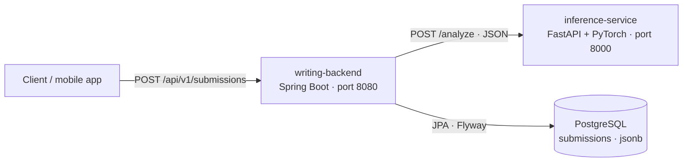

# TCF Writing Feedback — Spring Boot + AI inference platform

[](https://github.com/Zepe237/spring-ai-inference-platform/actions/workflows/ci.yml)


A backend platform that scores French written answers for the **TCF** (Test de connaissance du français)
and returns actionable feedback. A Spring Boot REST API stores the submissions in PostgreSQL and delegates
the analysis to a Python microservice that runs a PyTorch model behind FastAPI.

It grew out of [FeusapTCF](https://github.com/Zepe237), a TCF preparation app with 200+ active users:
the goal is to give learners instant feedback on the writing section.

## Architecture



1. The client sends a text and the TCF task (`TACHE_1`, `TACHE_2`, `TACHE_3`).
2. The backend calls the inference service, which extracts linguistic features and runs the model.
3. The backend stores the text, score, CEFR band, features and feedback, and returns them with `201 Created`.
4. If the model is down, the API answers `503` with a Problem Details body and stores nothing.

## What it demonstrates

**Spring Boot backend**
- Layered design: controller → service → repository, with request/response records kept apart from the JPA entity.
- PostgreSQL with Flyway migrations and `jsonb` columns mapped by Hibernate.
- `RestClient` call to another service, timeouts from configuration, remote failures mapped to `503`.
- Validation and RFC 9457 Problem Details errors, OpenAPI documentation, Actuator health.
- The remote call runs outside any transaction so no database connection waits on the model.

**Inference microservice**
- FastAPI with Pydantic request/response models.
- Feature extraction (word count, sentence length, lexical diversity, discourse connectors, long words).
- A PyTorch `nn.Module` that turns the features into a score out of 20 and an indicative CEFR band, with per-feature contributions so the result is explainable.
- Pluggable weights: train on graded essays and load the checkpoint with `MODEL_WEIGHTS_PATH`.

**Engineering**
- Unit tests (JUnit 5, Mockito, pytest), HTTP client test with `MockRestServiceServer`, and full API tests against a real PostgreSQL started by **Testcontainers**.
- Multi-stage Docker images, Docker Compose for the whole stack, GitHub Actions CI for both services.

## Run it

Requirements: Docker.

```bash
docker compose up --build
```

```bash
curl -X POST http://localhost:8080/api/v1/submissions \
  -H "Content-Type: application/json" \
  -d '{"task":"TACHE_3","text":"D'"'"'abord, le télétravail permet de gagner du temps. Cependant, il peut isoler les employés. En conclusion, une formule hybride me semble la meilleure solution."}'
```

Example response:

```json
{
  "id": "6f1c…",
  "task": "TACHE_3",
  "score": 5.3,
  "band": "A2",
  "feedback": ["Texte trop court : 24 mots, visez entre 120 et 180."],
  "features": { "word_count": 24, "connector_count": 3, "lexical_diversity": 1.0, "…": "…" },
  "modelVersion": "baseline-0.1.0",
  "createdAt": "2026-10-21T02:15:00Z"
}
```

- Swagger UI: http://localhost:8080/swagger-ui.html
- Inference API docs: http://localhost:8000/docs

## Run the tests

```bash
cd backend && mvn verify                 # needs Maven 3.9+ and Docker for Testcontainers
cd inference-service && pip install --extra-index-url https://download.pytorch.org/whl/cpu -r requirements-dev.txt && python -m pytest
```

## About the model

The shipped weights are a **transparent baseline**: a linear layer initialised from a writing rubric
(length, sentence structure, vocabulary, cohesion, lexical richness). Scores are indicative and are not
official TCF results. The next step is to fine-tune on graded essays, or to swap the feature model for a
French transformer such as CamemBERT, without changing the API contract.

## Tech stack

Java 21 · Spring Boot 3.5 · Spring Data JPA · Hibernate · Flyway · PostgreSQL · RestClient · springdoc-openapi ·
Python 3.13 · FastAPI · Pydantic · PyTorch · JUnit 5 · Mockito · Testcontainers · pytest · Docker · GitHub Actions
